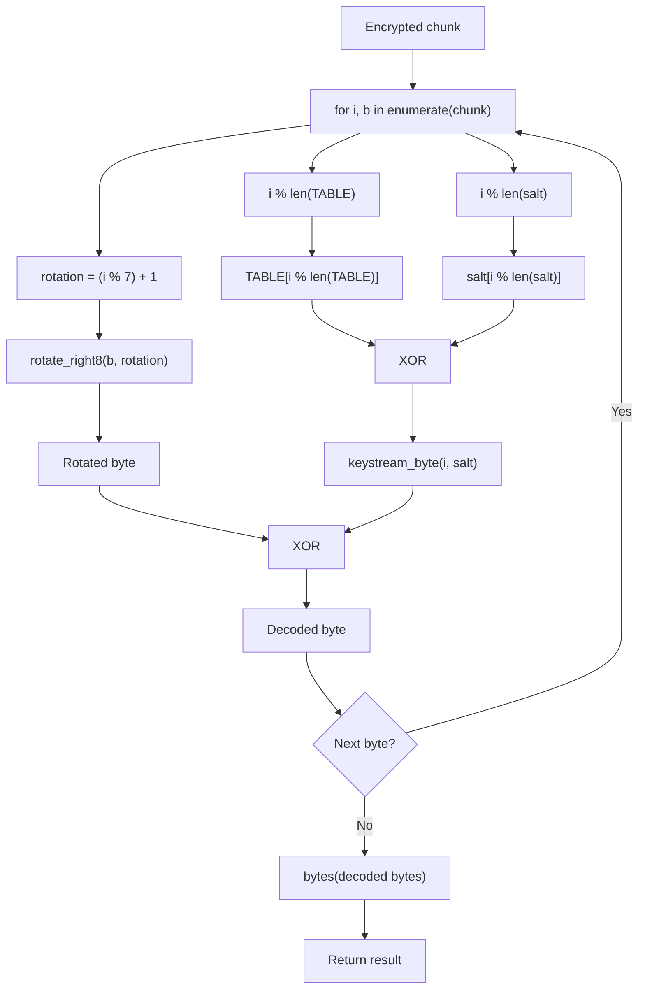

# Challenge Info
-----------
| Field | Details |
| --- | --- |
| CTF | BrunnerCTF |
| Challenge | One-Voice |
| Category | Android / Reverse Engineering |

# Solution
-----
We can start by decompiling the APK in jadx       
The APK has a MainActivity and a class `StatementStore`, The flag logic is present in the latter class.

```
private final byte[] readArchive(Context context, int resId) {
        Object objM151constructorimpl;
        try {
            Result.Companion companion = Result.INSTANCE;
            StatementStore statementStore = this;
            InputStream inputStreamOpenRawResource = context.getResources().openRawResource(resId);
            try {
                InputStream inputStream = inputStreamOpenRawResource;
                Intrinsics.checkNotNull(inputStream);
                byte[] bytes = ByteStreamsKt.readBytes(inputStream);
                CloseableKt.closeFinally(inputStreamOpenRawResource, null);
                objM151constructorimpl = Result.m151constructorimpl(bytes);
            } finally {
            }
        } catch (Throwable th) {
            Result.Companion companion2 = Result.INSTANCE;
            objM151constructorimpl = Result.m151constructorimpl(ResultKt.createFailure(th));
        }
        return (byte[]) (Result.m157isFailureimpl(objM151constructorimpl) ? null : objM151constructorimpl);
    }
```

The class has a method which reads a file from `res/raw`, which we can confirm by inspecting the 
`res/raw` in jadx - A `message.bin` file is present in that dir.

```
public final byte[] decode(byte[] encoded, byte[] salt) {
        Intrinsics.checkNotNullParameter(encoded, "encoded");
        Intrinsics.checkNotNullParameter(salt, "salt");
        byte[] bArr = new byte[encoded.length];
        int length = encoded.length;
        for (int i = 0; i < length; i++) {
            bArr[i] = (byte) (rotateRight8(encoded[i] & UByte.MAX_VALUE, (i % 7) + 1) ^ keystreamByte(i, salt));
        }
        return bArr;
    }
```

The APK has a custom decode function with salt

```
public final byte[] decode(byte[] encoded, byte[] salt) {
        Intrinsics.checkNotNullParameter(encoded, "encoded");
        Intrinsics.checkNotNullParameter(salt, "salt");
        byte[] bArr = new byte[encoded.length];
        int length = encoded.length;
        for (int i = 0; i < length; i++) {
            bArr[i] = (byte) (rotateRight8(encoded[i] & UByte.MAX_VALUE, (i % 7) + 1) ^ keystreamByte(i, salt));
        }
        return bArr;
    }
private final byte[] salt() {
        byte[] bytes = "onevoice-2026-W27".getBytes(Charsets.US_ASCII);
        Intrinsics.checkNotNullExpressionValue(bytes, "getBytes(...)");
        return bytes;
    }
```
The salt used for encryption is `onevoice-2026-W27`.We can use python to reverse the encoding, the encoded text is present in the file `message.bin`.        
The salt and the look-up table is hardcoded in the APK itself.

```
private static final byte[] TABLE = {63, -95, 8, -44, 98, -100, 23, -27, 75, 122, -61, 46, -111, 86, -67, -16};
```

So, our python script should:


We can write a script which does the above decoding,

```
TABLE = bytes([63, 161, 8, 212, 98, 156, 23, 229, 75, 122, 195, 46, 145, 86, 189, 240])
SALT = b"onevoice-2026-W27"

def rotate_right8(value, count):
    count &= 7
    value &= 0xFF
    return ((value << (8 - count)) | (value >> count)) & 0xFF if count else value

def keystream_byte(pos, salt):
    return TABLE[pos % len(TABLE)] ^ salt[pos % len(salt)]

def decode(chunk, salt):
    return bytes(
        rotate_right8(b, (i % 7) + 1) ^ keystream_byte(i, salt)
        for i, b in enumerate(chunk)
    )

def unpack(blob):
    entries = []
    pos = 1
    for _ in range(blob[0]):
        length = (blob[pos] << 8) | blob[pos + 1]
        start = pos + 2
        entries.append(blob[start:start + length])
        pos = start + length
    return entries

with open("messaging.bin", "rb") as f:
for i, record in enumerate(unpack(archive)):
    print(f"[{i}] {decode(record, SALT).decode('utf-8', errors='replace')}")
```

We save this as a `.py` and run this to get :

```
[0] Approved wording — week 2026-W27

Brunnerne A/S is aligning its footprint to demand. No decisions have been taken, and we will communicate with colleagues before we communicate externally.

Cleared by Corporate Communications. Please use verbatim.
[1] DRAFT — NOT FOR CIRCULATION — week 2026-W27

The Aarhus site closes at the end of Q3. Thirty-one roles go; the board signed it off on 12 June. Communications will not confirm a number until consultation has formally opened, so the line for now is that no decisions have been taken.

Do not send this to anyone outside Communications.

brunner{th3_dr4ft_sh1pp3d_w1th_th3_4ppr0v4l}

```
# Flag
-------------
```text
Flag : brunner{th3_dr4ft_sh1pp3d_w1th_th3_4ppr0v4l}
```